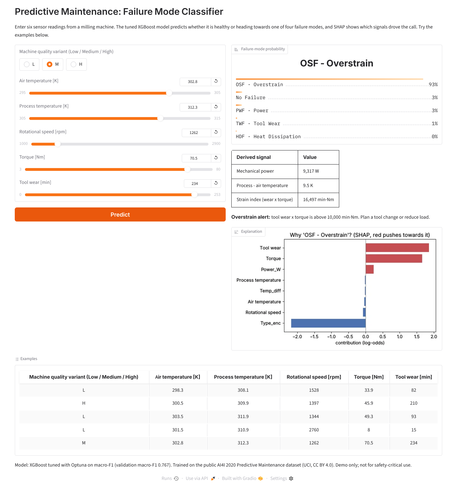
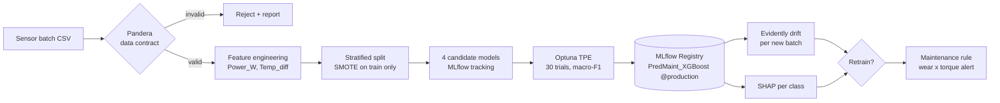
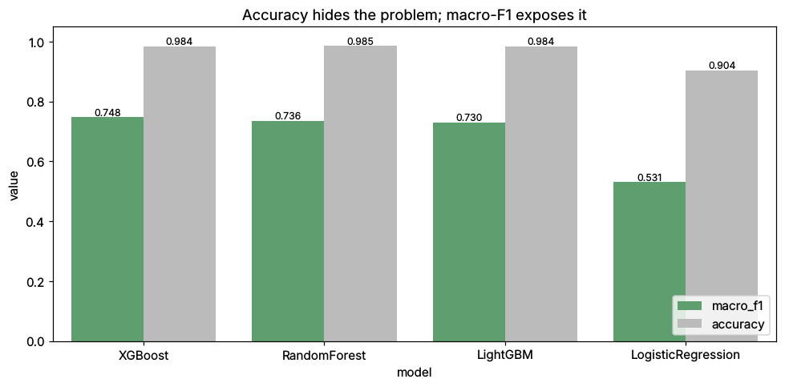
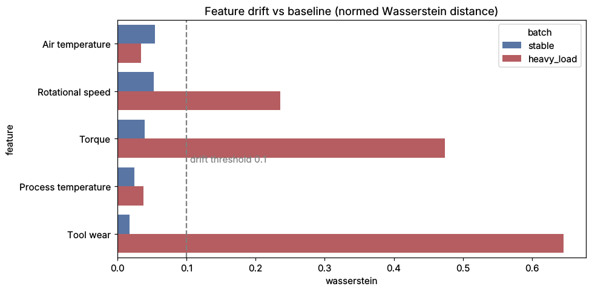
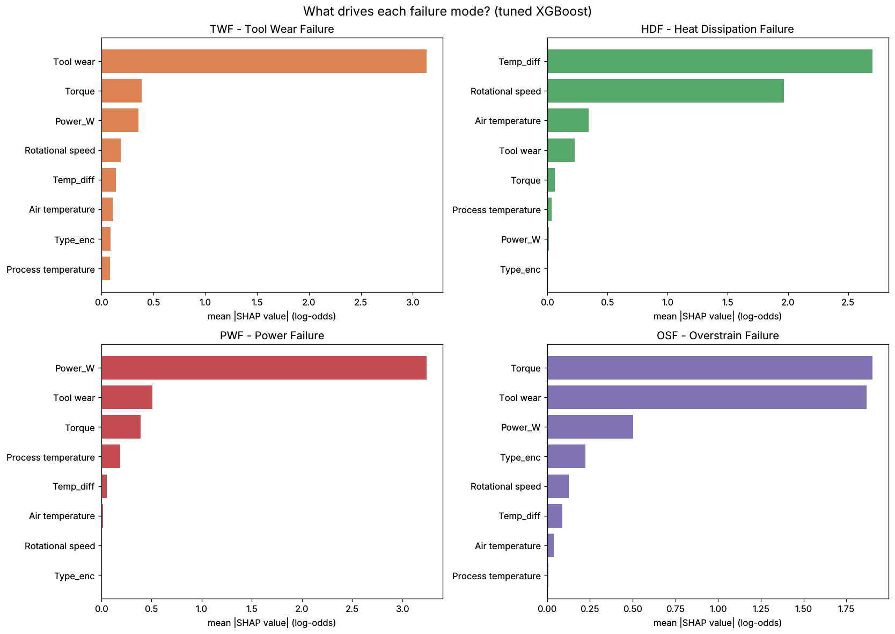

# Predictive Maintenance MLOps: Failure-Mode Classification with Drift Monitoring

**A complete MLOps loop for predicting machine failures before they happen and knowing when the model has stopped being trustworthy.**

`validate → train → track → tune → monitor → explain → decide`

[](https://github.com/kritikesh28/predictive-maintenance-mlops/actions)


[](https://huggingface.co/kritikesh28/predictive-maintenance-xgboost)
[](https://curioussparoows.com/portfolio/predictive-maintenance-mlops/)



---

## The problem

On a manufacturing line, an unplanned machine stop halts production, while a planned tool change costs minutes. Each machine streams six signals: machine type, air temperature, process temperature, rotational speed, torque and tool wear. The goal is to tell, from one reading, whether a machine is healthy or heading towards one of four failure modes:

| Code | Failure mode | Share of data |
|---|---|---|
| 0 | No Failure | 96.70 % |
| 1 | **TWF**: Tool Wear Failure | 0.43 % (30 rows) |
| 2 | **HDF**: Heat Dissipation Failure | 1.09 % |
| 3 | **PWF**: Power Failure | 0.80 % |
| 4 | **OSF**: Overstrain Failure | 0.99 % |

There are two hard parts:
1. **Extreme imbalance.** A model that always says "healthy" scores 96.7% accuracy and catches nothing.
2. **The world changes after deployment.** A heavy-load production period produces data that is perfectly *valid* but statistically *different*, and the model silently degrades.

This project addresses both and turns the outputs into a concrete maintenance rule.

## Architecture



| Stage | Tool | What it does here |
|---|---|---|
| Data contract | **Pandera** | Enforces physical ranges and types for all 7 columns, with lazy validation that reports every violation |
| Features | pandas / NumPy | `Power_W = Torque × 2π·rpm/60`, `Temp_diff = T_process − T_air` |
| Imbalance | **imbalanced-learn** | SMOTE (`k_neighbors=3`) applied **after** the split, to the training fold only |
| Tracking | **MLflow** | Params, macro/weighted F1, accuracy and per-class F1 for every run, plus logged models |
| Tuning | **Optuna** | TPE sampler (seed 42), 9-dimensional XGBoost search space, optimising macro-F1 |
| Registry | **MLflow Model Registry** | `PredMaint_XGBoost`, promoted via the `production` alias |
| Monitoring | **Evidently** | Dataset and per-feature drift (normed Wasserstein, threshold 0.1), saved as HTML reports |
| Explainability | **SHAP** | TreeExplainer, read **per failure class** (not one global ranking) |
| Demo | **Gradio** | Live classifier with per-prediction SHAP explanation and an overstrain alert |

## Results

All numbers come from `python -m predmaint.pipeline` (seed 42). Validation is a stratified 20% hold-out of the baseline data, which SMOTE never touches.

### 1. Model selection: accuracy hides the problem

| Model | **Macro-F1** | Weighted-F1 | Accuracy | TWF F1 | HDF F1 | PWF F1 | OSF F1 |
|---|---|---|---|---|---|---|---|
| **XGBoost** | **0.748** | 0.985 | 0.984 | 0.133 | 0.966 | 0.880 | 0.769 |
| Random Forest | 0.736 | 0.986 | **0.985** | 0.000 | 0.929 | 0.957 | 0.800 |
| LightGBM | 0.730 | 0.985 | 0.984 | 0.000 | 0.966 | 0.833 | 0.857 |
| Logistic Regression | 0.531 | 0.933 | 0.904 | 0.145 | 0.455 | 0.458 | 0.650 |
| **XGBoost + Optuna** | **0.767** | 0.983 | 0.977 | 0.069 | 0.966 | 0.917 | **0.897** |



Random Forest has the *highest accuracy* but misses every tool-wear failure. Ranking by **macro-F1**, which weights each failure mode equally, picks XGBoost. Tuning adds +0.019 macro-F1 (+2.6%), and most of the gain is on overstrain (OSF F1 0.77 → 0.90).

### 2. Monitoring: valid is not the same as in-distribution

Both production batches **pass the Pandera contract with 0 violations**. Evidently tells a different story:

| Batch | Dataset drift | Drifted features | Model macro-F1 | OSF F1 | OSF prevalence |
|---|---|---|---|---|---|
| Stable | No | 0 / 5 | 0.742 | 0.813 | 1.00 % |
| **Heavy-load** | **Yes** | **3 / 5** | **0.532** | **0.626** | **3.87 %** |

| Feature (heavy-load batch) | Wasserstein | Baseline mean | Batch mean | Δ |
|---|---|---|---|---|
| Tool wear | **0.646** | 107.7 min | 148.9 min | **+38.3 %** |
| Torque | **0.474** | 40.0 Nm | 44.7 Nm | **+11.8 %** |
| Rotational speed | **0.235** | 1539 rpm | 1497 rpm | −2.7 % |
| Process temperature | 0.038 | 310.0 K | 310.0 K | 0.0 % |
| Air temperature | 0.034 | 300.0 K | 300.1 K | 0.0 % |



Interactive reports: [`reports/drift/drift_stable.html`](reports/drift/drift_stable.html) · [`reports/drift/drift_heavy_load.html`](reports/drift/drift_heavy_load.html)

### 3. Explainability: each failure mode has its own physics



| Failure mode | Top driver (mean \|SHAP\|) | Physical reading |
|---|---|---|
| TWF | Tool wear (3.13) | The tool reaches end of life at about 200–240 min. This is a time-based failure. |
| HDF | **Temp_diff** (2.70), then rpm (1.97) | A small air-to-process temperature gap plus low spindle speed means heat cannot escape. |
| PWF | **Power_W** (3.24) | Power outside a safe band, either a stall (too low) or an overload (too high). The engineered feature is about 8× stronger than raw torque. |
| OSF | Torque (1.90), Tool wear (1.87) | A worn tool under high torque exceeds the strain limit. |

The two engineered features are the #1 drivers of two failure modes, which justifies the domain-informed feature engineering.

### 4. Decision

**Drifted features → affected failure mode → action.** Torque and tool wear (the two most drifted features) are the top two SHAP drivers of **overstrain**. Overstrain prevalence rose 4× and its F1 fell from 0.90 to 0.63, so the pipeline outputs **`RETRAIN RECOMMENDED: True`**.

**Maintenance rule derived from the evidence:** alert when **`tool wear × torque > 10,000 min·Nm`**. Every overstrain failure in the baseline sits above about 11,000, and 11.4% of heavy-load readings exceed 11,000, against 1.3% under normal load. Tool-change intervals tuned for normal load are too long during heavy-load campaigns.

## Quick start

```bash
git clone https://github.com/kritikesh28/predictive-maintenance-mlops.git
cd predictive-maintenance-mlops
python -m venv .venv && source .venv/bin/activate      # Windows: .venv\Scripts\activate
pip install -r requirements-dev.txt && pip install -e .

python -m predmaint.pipeline        # full run, about 1-2 min on a laptop CPU, no GPU needed
pytest -q                           # 6 unit tests
python app/app.py                   # Gradio demo at http://127.0.0.1:7860
mlflow ui --backend-store-uri sqlite:///mlflow.db   # browse runs and the registry
```

Or use `make run`, `make test`, `make app` or `make mlflow`. Tested with Python 3.11.

Score your own readings:

```python
from predmaint.predict import load_model, predict
model = load_model()   # models/xgb_predmaint.joblib
predict(model, [{"Type": "M", "Air temperature": 302.8, "Process temperature": 312.3,
                 "Rotational speed": 1262, "Torque": 70.5, "Tool wear": 234}])
#   prediction  p_No Failure  ...  p_OSF  strain_index  strain_alert
#          OSF         0.032  ...  0.928       16497.0          True
```

## Repository layout

```
predictive-maintenance-mlops/
├── src/predmaint/
│   ├── config.py       # paths, features, seeds, registry names
│   ├── data.py         # loading + Pandera data contract
│   ├── features.py     # Power_W, Temp_diff, strain index
│   ├── train.py        # split + SMOTE, model comparison, Optuna, registry (MLflow)
│   ├── monitor.py      # Evidently drift reports
│   ├── explain.py      # per-class SHAP
│   ├── plots.py        # README figures
│   ├── predict.py      # inference API
│   └── pipeline.py     # end-to-end CLI: python -m predmaint.pipeline
├── notebooks/predictive_maintenance_walkthrough.ipynb   # narrated, executed walkthrough
├── app/app.py          # Gradio demo (run locally; a browser version is live on the project page)
├── tests/              # pytest: contract, feature physics, inference
├── configs/params.yaml # run configuration at a glance
├── data/               # baseline + two production batches (see data/README.md)
├── models/             # tuned XGBoost (.joblib + native .json)
├── reports/            # metrics.json, leaderboard.csv, figures/, drift/
└── .github/workflows/ci.yml   # tests + smoke pipeline on every push
```

## Design decisions

- **Macro-F1 as the selection metric.** Each failure mode counts equally. Accuracy is reported but never used to choose a model.
- **Split first, then SMOTE.** Oversampling before the split leaks synthetic copies of validation rows into training and inflates scores.
- **`k_neighbors=3`.** The rarest class has only 24 training rows, and the default of 5 makes neighbourhoods too wide.
- **Separate validation and drift checks.** Pandera answers "is this batch physically possible?" and Evidently answers "is this batch like what the model learned from?". The heavy-load batch passes the first and fails the second.
- **Per-class SHAP.** In a multiclass model the same feature can push one class up and another down, so one global ranking would hide that.
- **Registry alias, not stage.** `production` is a movable alias, so promotion and rollback are a single pointer change.

## Limitations

- **Tool-wear failure is not solved** (F1 ≈ 0.07). There are only 30 real examples, and SMOTE interpolates between 24 points without creating real variety. The fix is data: log every tool change with its wear at failure, and add vibration or acoustic sensing. Until then, a rule-based tool-life limit covers TWF.
- The data is the synthetic AI4I 2020 benchmark, so thresholds such as 10,000 min·Nm would need recalibrating on real plant data.
- Validation is a single stratified hold-out. With only 6 TWF rows in validation, per-class F1 for TWF is noisy, and repeated stratified CV would give tighter estimates.
- Monitoring is batch-based (offline reports), not a streaming service.

## What I'd do next

1. Retrain on a window that includes heavy-load data, and promote only if the challenger beats `@production` on a held-out heavy-load slice (champion/challenger).
2. Cost-sensitive decision thresholds: a missed failure costs far more than a false alarm.
3. Schedule drift checks (GitHub Actions cron or Airflow) with automatic retrain triggers.
4. Serve the registered model behind a FastAPI endpoint with request logging, so it can monitor its own production traffic.

## Data and credits

Data derived from the **AI4I 2020 Predictive Maintenance Dataset**, UCI Machine Learning Repository, [CC BY 4.0](https://creativecommons.org/licenses/by/4.0/) (S. Matzka, 2020). See [`data/README.md`](data/README.md).
Built with scikit-learn, XGBoost, LightGBM, imbalanced-learn, MLflow, Optuna, Evidently, SHAP, Pandera and Gradio.

## Author

**Kritikesh Rajpurohit** · [LinkedIn](https://www.linkedin.com/in/kritikesh-rajpurohit-6b3043195) · [Hugging Face](https://huggingface.co/kritikesh28) · [GitHub](https://github.com/kritikesh28) · [Project page (English and Hindi)](https://curioussparoows.com/portfolio/predictive-maintenance-mlops/)

Capstone project of the Applied AI and Agentic AI programme, IIIT Bangalore. The analysis was first done in a notebook; this repository version (package layout, tests, CI and the Gradio demo) was designed with Claude.

Code: MIT licence. Data: CC BY 4.0.
